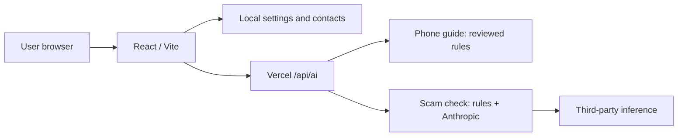

# 01 — Current state audit
**As of 17 October 2026 | verification-aware**

## Evidence and limits
Inspected GitHub `main`, merge of PR #1, repo tree and relevant source files. Main merge commit: `9de5d5f358f2d3b4038ac6d36fe29b42d106058b`. Historical audit: [8 Oct audit](AUDIT-2026-10-08.md). Live URL fetch failed in current environment; equivalence between deployment and main **UNVERIFIED**. Local clone blocked by GitHub DNS in test environment, so current npm tests and browser flows **UNVERIFIED**.

## Actual architecture
React 18 + TypeScript + Vite PWA frontend, React component state and browser `localStorage`; a Vercel TypeScript function `api/ai.ts`; `server/check.ts` performs deterministic rules and Anthropic-based analysis; `server/phoneHelp.ts` uses reviewed deterministic guides. No user-account authentication, server database or subscribed billing in inspected tree. Human contacts stored locally; WhatsApp draft does not mean a message was delivered.

## Current-feature inventory and decision
| Feature | User value / recurring job | Core risk | Action |
|---|---|---|---|
| Ask Phone, 9 guides | small recurring assistance, cheap to serve | keyword misrouting, narrow scope | **IMPROVE**, route toward device-aware outcomes |
| Scam message/screenshot analysis | intermittent high-severity risk | false reassurance, provider costs and privacy | **KEEP as safety entry point**, not headline paid product |
| Emergency and money-sent instructions | urgently valuable | country-specific contact freshness | **KEEP, never paywall** |
| Verify official service numbers | redirects away from phishing | stale directory entries | **IMPROVE**, owner and verification cadence |
| Trusted Circle phone/WhatsApp draft | manual connection to trusted help | no delivery, acknowledgment or consent tracking | **IMPROVE**, never claim automatic escalation |
| Scam practice quiz | optional confidence building | gamified engagement not real outcome | **DEMOTE**, leave optional |
| Accessibility, voice and languages | critical inclusion | browser speech inconsistency | **KEEP + device verification** |

## Specific reviewed findings
1. Prior unrestricted Ask Phone scope bypass was historically reproduced. Merged PR #1 replaced unrestricted generation with deterministic reviewed guides; current runtime behavior is not independently re-tested.
2. `api/ai.ts` has an origin-host check but that does not authenticate non-browser callers. `server/rateLimit.ts` limits in memory per runtime, not distributed: **high risk of spend abuse** if publicly available.
3. Human-sharing consent exists as manual sending but no recipient acceptance/verified receipt. Do not promise assisted case resolution yet.
4. No instrumented real-user task outcomes or paid conversion, and no verified customer demand. **Business risk critical.**
5. Storing only limited task outcomes locally improves minimisation, but prevents cohort analysis across browsers or proof of institutional ROI without opt-in telemetry.

## Initial founder diagnosis
A stand-alone scam-warning UI is easily bundled by messaging and platform providers. Recurring digital task completion with measurable successful outcomes has a plausible payer (institutions absorbing support costs), but needs interviews and paid pilots before being considered validated.

## Open engineering risks
No distributed API quota, verified privacy notice and retention schedule for processed screenshot data, managed guide expiry, real mobile/screen-reader QA, cross-device identity, institutional auth, secure case data and formal incident response. Existing tests are historical, not current CI evidence.
