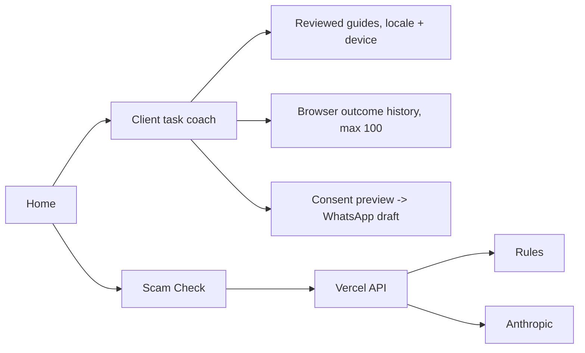

# Architecture — actual branch design

React 18 + TypeScript + Vite frontend, per-user browser localStorage, Vercel serverless `/api/ai`, Anthropic only in scam checks. Coach guide/step progression and outcome persistence execute in browser, no institution endpoint/auth. Security boundary: user input never chooses an executable tool; task IDs allowlisted; WhatsApp draft manually reviewed. See `src/lib/coach.ts`, `src/screens/Coach.tsx`, `api/ai.ts`.
